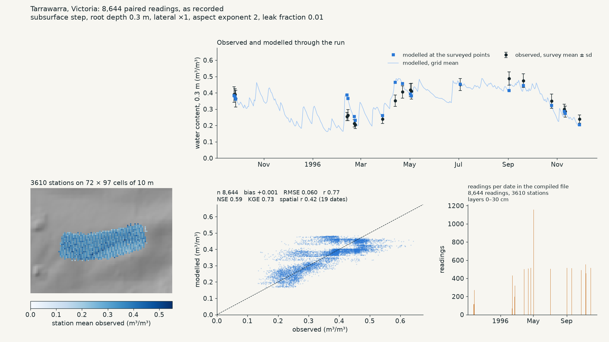
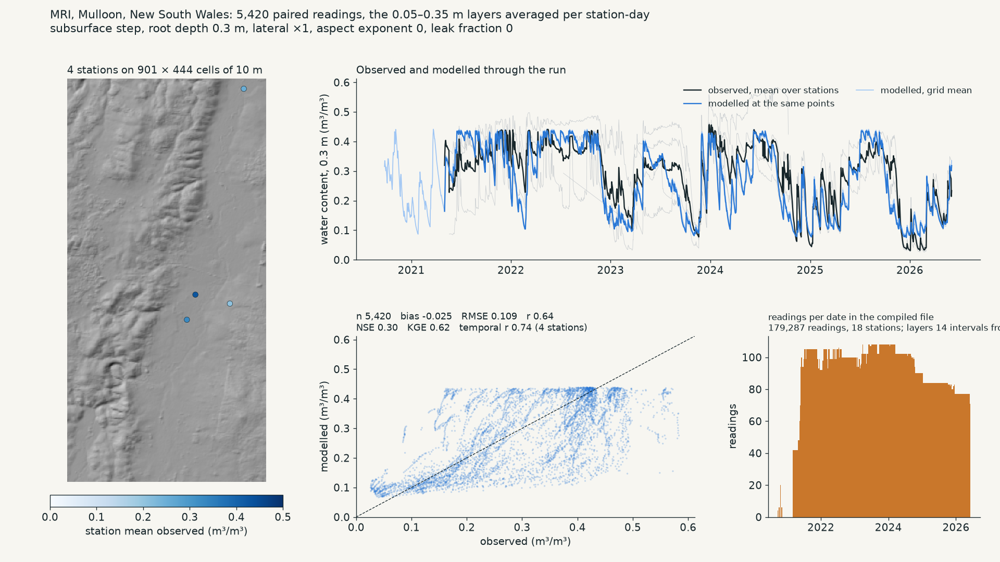
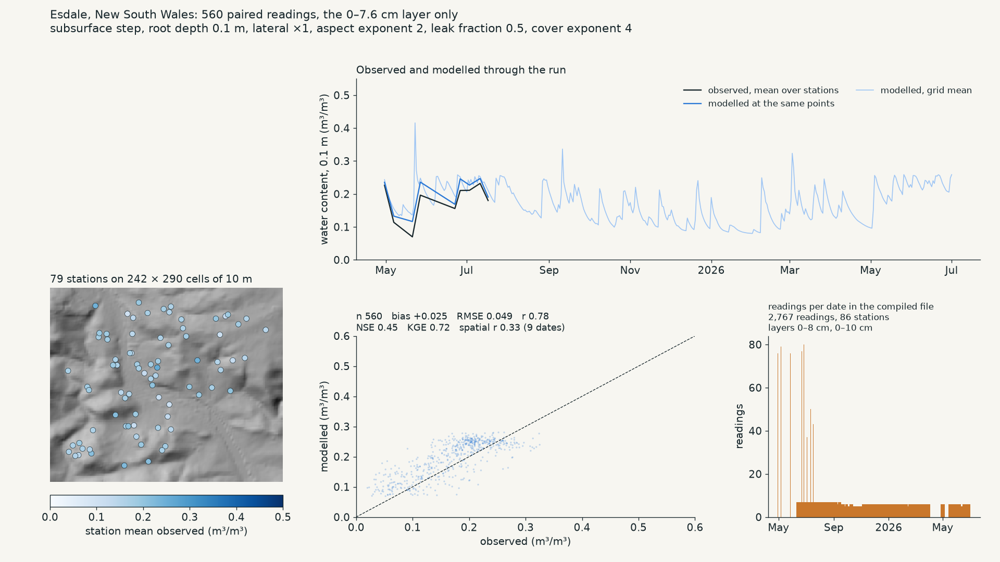
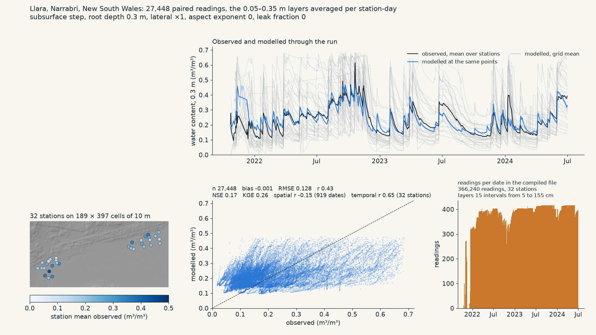
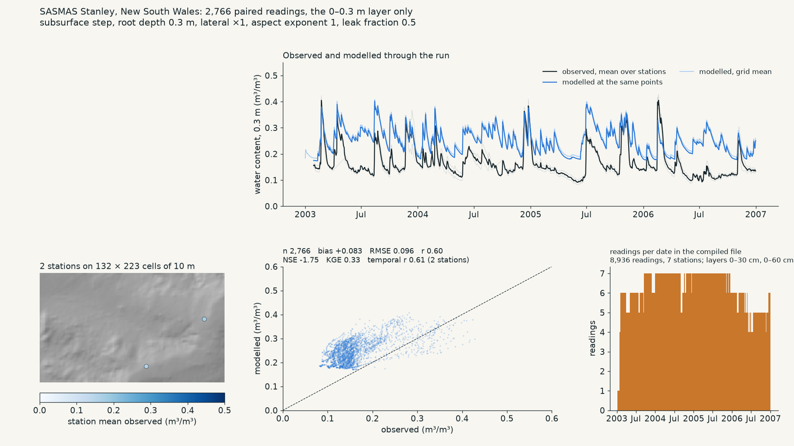

# Evaluation

<!-- nav -->
← [Observations](observations.md) · [Index](README.md) · [Ingest](ingest.md) →
<!-- /nav -->

Five of the six committed sites have observations. Each was scored at a small hand-chosen grid of the levers, every configuration on the site's full observation set, and a setting was chosen by reading the scores together. This page records the method, the settings, the results, and what each site constrains. It is an in-sample selection, not a calibration in the statistical sense; the caveats are at the end.

## Method

- One configuration is one run of a step on the site's committed inputs at the calibrated soil conventions, started at the first survey's observed mean, read at each observation's cell and day as θwp + stored / depth, and scored with `score_pairs` and `score_pairs_by_key` ([observations.md](observations.md)).
- Scores are read together rather than as one objective: bias and NSE/KGE (level and timing), the mean within-date r over dates with at least 20 points (spatial pattern), the mean per-station r over stations with at least 30 readings (timing at a point), and the ratio of modelled to observed within-date spread.
- The grid run: lateral multiplier {1, 3, 10, 30}, aspect exponent {0, 1, 2}, percolation fraction {0, 0.01, 0.05} and, where the surface store required it, {0.2, 0.5, 1}, cover exponent {0.5, 1, 2, 4, 6, 8} absolute or relative to the site mean. Tarrawarra 50 configurations, Esdale 23, SASMAS 11, MRI 9, Llara 8.
- How each site's layers were read against the model's store:

| Site | Model depth | Observations used |
|---|---|---|
| Tarrawarra | 0.3 m | as recorded, 0–0.3 m TDR |
| Esdale | 0.1 m | the 0–7.6 cm hand campaign only; the loggers (compressed range) inform timing only |
| MRI | 0.3 m | the three 10 cm logger layers from 0.05 to 0.35 m averaged per station-day, complete triples only (4 of the 18 profiles, 5,420 station-days) |
| Llara | 0.3 m | the same |
| SASMAS Stanley | 0.3 m | the 0–0.3 m layer only |

## Settings and scores

Scores in m³/m³ where dimensional; the subsurface step throughout.

| Site | Chosen setting | bias | NSE | KGE | spatial r | temporal r | What decided it |
|---|---|---|---|---|---|---|---|
| Tarrawarra | lateral 1, aspect 2, percolation fraction 0.01 | +0.001 | 0.59 | 0.73 | 0.42 | – | aspect 0→1→2 lifts spatial r 0.22→0.40→0.42; lateral 3/10/30 never raises it and 10+ costs NSE; percolation fraction 0.01 removes a +0.03 bias at no NSE cost, 0.05 collapses NSE to 0.2; any cover above 0 lowers spatial r |
| MRI | lateral 1, aspect 0, percolation fraction 0 (impermeable base) | −0.025 | 0.30 | 0.62 | – | 0.74 (4 profiles with complete triples) | the subsurface store lifts NSE from −0.64; any leak lowers it (0.22 at 0.01); aspect 0 and 1 score identically, so aspect is untested here; cover 1 raises temporal r to 0.79 but adds +0.04 bias |
| Esdale | lateral 1, aspect 2, percolation fraction 0.5, cover 4 (relative) | +0.025 | 0.45 | 0.72 | 0.33 | – | a free store with percolation fraction ≤ 0.01 is catastrophic in a 0.1 m layer (bias +0.17, NSE −8); percolation fraction 0.5 returns it to the bucket's level; relative cover 2→4 lifts spatial r −0.13→0.24→0.33; 6 and 8 over-spread |
| Llara | defaults; nothing chosen | −0.001 | 0.17 | 0.26 | negative | 0.65 | every configuration within NSE 0.10–0.17; the levers are inert on flat ground |
| SASMAS Stanley | nothing chosen | +0.08–0.09 | negative | ~0.3 | – | ~0.6 | bias +0.08 under all eleven configurations |

## What each site constrains

- **Tarrawarra** (3,610 TDR points, 13 surveys, 1995–96) is the only Australian dataset that tests a 10 m pattern directly. The closed bucket cannot exceed the SLGA field capacity (0.30 m³/m³) and falls 0.15 below the winter surveys; the subsurface store reaches them. The pattern within a survey is organised by aspect during drying (observed content against the cell's solar ratio on 27 September 1995: r −0.71 over 270 points), and the aspect lever carries it; lateral redistribution is present but does not organise it. The modelled within-survey spread remains 0.43 of the observed: each survey forms a near-horizontal band on the scatter.
- **MRI, Mulloon** (18 logger profiles, 2020–26, about a third tree cover) repeats Tarrawarra's result on the level and prefers an impermeable base; it has too few complete profiles to assess the spatial pattern or the tree-rooting lever.
- **Esdale** (78-point hand campaign on 9 dates at 0–7.6 cm, plus 7 loggers) shows a surface layer that needs free drainage, and persistent cover lowering water content independently of aspect (partial r −0.56 in the campaign); the loggers show a compressed range and inform timing only. The hand campaign was more diagnostic than the loggers.
- **Llara, Narrabri** (32 logger profiles in two clusters, 2021–24) is flat cropping land, so no terrain lever applies. The probes read above porosity and below wilting point; the soil map and two nearby APSoil profiles agree, so the sensors need calibration before the site can constrain anything.
- **SASMAS Stanley** (7 stations, 2 reporting 0–0.3 m, 2003–06) observes 0.17 where the soil map's field capacity is 0.38: the one site where the soil map appears to misdescribe the soil, in the opposite direction to every other.

Three of the five remaining disagreements lie in the data rather than the model: two sensor sets and one soil-map pixel. The evaluation loop is what separated them.

## The soil-convention calibration

The levels at four of five sites sat off the soil curve before PR 26. The cause was an input, the SLGA-plus-Campbell route to field capacity, so it was measured against Australian soils under the same soil map rather than fitted to the sites: at 205 surveyed APSoil profiles the field capacity at −33 J/kg sat 0.09 m³/m³ below the measured drained upper limit with the ranking right, and −10 J/kg reproduces it ([soil.md](soil.md)). Every site was re-ingested and every lever re-measured: the bucket's bias halved at four sites; the subsurface step improved at MRI and Llara and held at Tarrawarra, where the free store had been compensating for the convention; the anisotropy's earlier case was found to rest partly on the old field capacity; SASMAS worsened.

## Per-site figures

Each figure shows where the stations are on the terrain (coloured by their mean observed content), observed and modelled content through the run at the paired points with the grid mean beside them, every pair against the 1:1 line with the scores, and the readings per date in the compiled file with the depth layers it holds.

- 
- 
- 
- 
- 

## Caveats

- Settings were selected on the data they are scored against, over a coarse hand-picked grid; the scores above are optimistic and carry no uncertainty. Aspect 2 is the top of the range tried at Tarrawarra. The planned guard is to select on some sites and score on others, and to calibrate on the national networks with the dense sites held out.
- Rain at 5 km, soil at 90 m and elevation at 30 m sit under the 10 m grid; the model inherits each input's pattern.
- The service's comparison route pairs every reading in a site's file at the run's root depth and starts from `initial_fullness`, so the numbers on the run page differ from this page's (e.g. MRI NSE −0.13 on the page against 0.30 here).

<!-- nav -->
← [Observations](observations.md) · [Index](README.md) · [Ingest](ingest.md) →
<!-- /nav -->
