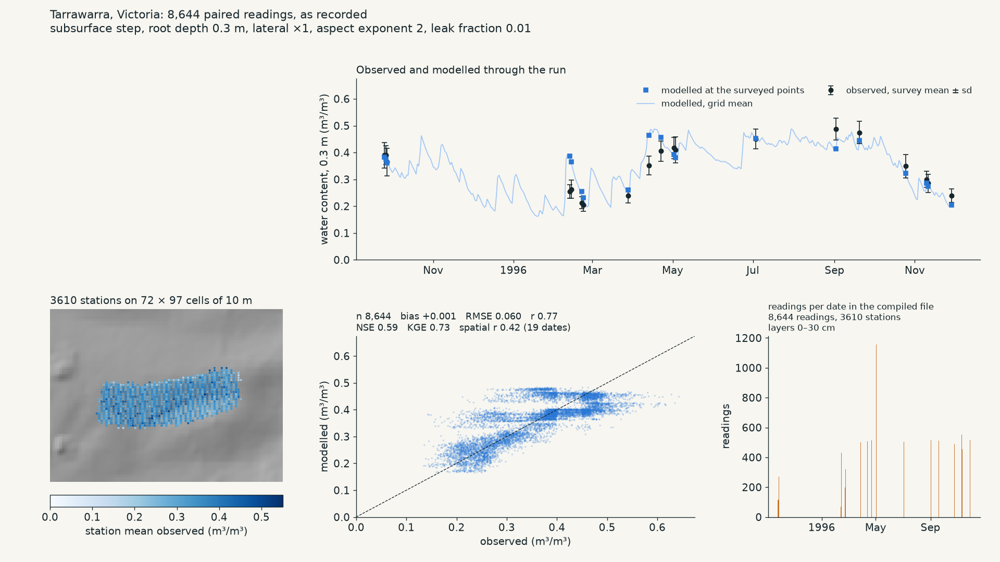
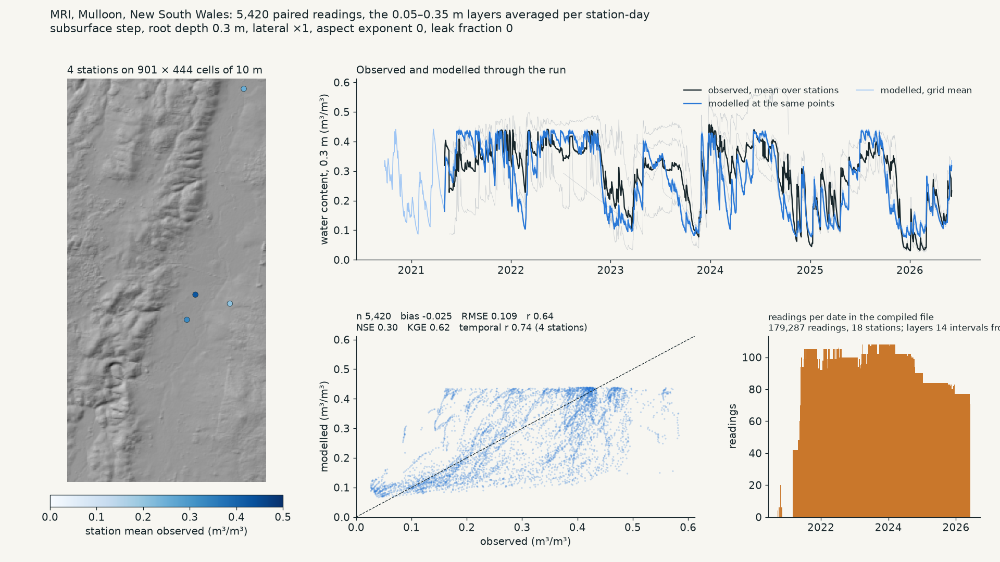
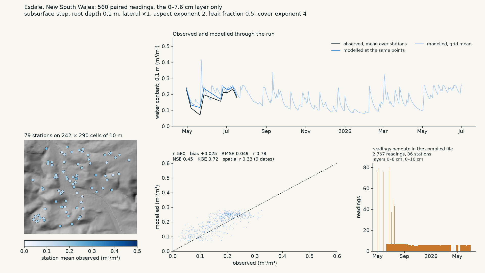
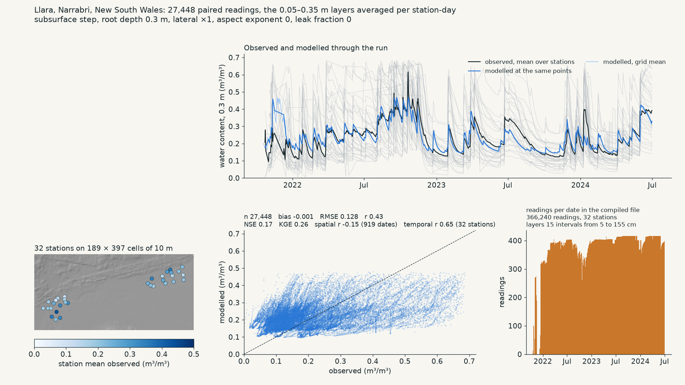
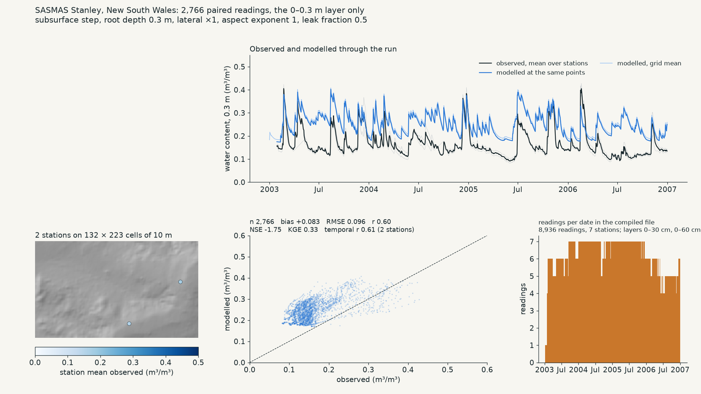

# Evaluation

<!-- nav -->
← [Observations](observations.md) · [Index](README.md) · [Ingest](ingest.md) →
<!-- /nav -->

This page records how the subsurface step's settings were chosen at five sites and the scores obtained. Read the provenance and limitations first.

## Provenance

- The settings and scores below were produced between 7 and 8 November 2026 by scripts that are not in the repository. They cannot be reproduced from the repository alone.
- On 11 November 2026 the Tarrawarra row was reproduced with the code at `4f45710` (bias +0.001, RMSE 0.060, r 0.772, NSE 0.588, KGE 0.732). The other rows have not been re-run since they were recorded.
- The per-site figures in `docs/figures/` were drawn by the same out-of-repository scripts. Their headers use the earlier parameter names: "leak fraction" for `percolation_fraction` and "aspect exponent" for `aspect_strength`.

## Limitations

- **In-sample selection.** Each site's setting was chosen by reading the scores of a few hand-picked configurations, and scored on the same observations. The scores are therefore optimistic. No data were held out.
- **No uncertainty.** No uncertainty or sensitivity analysis was done beyond the configurations listed. Aspect strength 2 is the largest value tried at Tarrawarra.
- **Start state.** Runs start from the observed mean content of the first observation date, not from a spin-up.
- **Depth matching.** The model has one store over the root depth. Observations at other depths were matched by selecting or averaging layers per site, as listed under Method.
- **Input resolution.** Rain is uniform across each site, since each lies within about one 5 km SILO tile. Soil varies in 90 m blocks and elevation carries 30 m detail.
- **Differs from the service.** The service's comparison route starts from `initial_fullness` and pairs every record at the run's root depth, so it gives different numbers from this page. For example, MRI gives NSE −0.13 on the run page and 0.30 here.

## Method

One configuration is one run of the subsurface step on the committed inputs, with the soil conventions at −10/−500 J/kg. Each run is read at every observation's cell and date as θwp + moisture / root depth, and scored with `score_pairs` and `score_pairs_by_key`.

Configurations tried, counted per site: Tarrawarra 50, Esdale 23, SASMAS Stanley 11, MRI 9, Llara 8. They were drawn from these values:

- lateral multiplier ∈ {1, 3, 10, 30};
- aspect strength ∈ {0, 1, 2};
- percolation fraction ∈ {0, 0.01, 0.05}, and {0.2, 0.5, 1} where a surface layer was scored;
- cover strength ∈ {0.5, 1, 2, 4, 6, 8}.

Not every combination was run.

Scores were read together:

- bias, NSE and KGE over the whole run;
- the mean within-date r over dates with at least 20 records, for the spatial pattern;
- the mean per-station r over stations with at least 30 records, for timing.

| Site | Model root depth | Observations scored |
|---|---|---|
| Tarrawarra | 0.3 m | 0–0.3 m TDR, all records |
| Esdale | 0.1 m | 0–0.076 m hand campaign only (560 records); loggers excluded |
| MRI | 0.3 m | The 0.05–0.15, 0.15–0.25 and 0.25–0.35 m layers averaged per station-day; only station-days with all three (4 of 18 profiles, 5,420 station-days) |
| Llara | 0.3 m | As MRI |
| SASMAS Stanley | 0.3 m | 0–0.3 m layer only (2 of 7 stations) |

## Settings and scores

Volumetric scores are in m³/m³. "–" means not computed, because there were too few records per date or per station.

| Site | Setting chosen | bias | NSE | KGE | within-date r | per-station r |
|---|---|---|---|---|---|---|
| Tarrawarra | lateral 1, aspect 2, percolation 0.01 | +0.001 | 0.59 | 0.73 | 0.42 | – |
| MRI | lateral 1, aspect 0, percolation 0 | −0.025 | 0.30 | 0.62 | – | 0.74 |
| Esdale | lateral 1, aspect 2, percolation 0.5, cover 4 | +0.025 | 0.45 | 0.72 | 0.33 | – |
| Llara | defaults; no setting changed the scores materially | −0.001 | 0.17 | 0.26 | negative | 0.65 |
| SASMAS Stanley | none chosen | +0.08 to +0.09 | negative | about 0.3 | – | about 0.6 |

How each setting was chosen, as recorded:

- **Tarrawarra.** Aspect strength 0, 1 and 2 gave within-date r of 0.22, 0.40 and 0.42. A lateral multiplier of 3, 10 or 30 did not raise it, and 10 or more lowered NSE. A percolation fraction of 0.01 removed a +0.03 bias without lowering NSE; 0.05 lowered NSE to about 0.2. Any cover strength above 0 lowered within-date r.
- **MRI.** Adding the free store (subsurface step) raised NSE from −0.64 to 0.30. Any percolation lowered NSE (0.22 at 0.01). Aspect 0 and 1 gave the same scores. Cover 1 raised per-station r to 0.79 and added +0.04 bias.
- **Esdale.** With a percolation fraction of 0.01 or less, the 0.1 m store held too much water (bias +0.17, NSE −8). A fraction of 0.5 brought the level back to the closed bucket's. Cover strength 2 and 4 raised within-date r from −0.13 to 0.24 and 0.33; 6 and 8 widened the modelled spread beyond the observed.
- **Llara.** All eight configurations gave NSE between 0.10 and 0.17.
- **SASMAS Stanley.** Bias was +0.08 or more in all eleven configurations.

## Observations at each site

- **Tarrawarra** is the only site with a survey at 10 to 20 m spacing. On 27 September 1995, observed content correlates with the cell's solar ratio at r −0.71 over 270 points. Under the chosen setting, the modelled spread within a survey is 0.43 of the observed spread.
- **MRI**: only 4 of 18 profiles have complete layers. That is too few to assess the within-date pattern or the tree root-depth setting.
- **Esdale**: in the hand campaign, cover correlates with lower content after controlling for aspect (partial r −0.56). The loggers' range is narrower than the campaign's.
- **Llara** is flat cropping land, so the terrain settings have little effect. Some logger records lie above the soil's saturated content or below its wilting point, as estimated from SLGA. Two nearby APSoil profiles agree with the SLGA estimate. The site cannot constrain the model until the sensors are checked.
- **SASMAS Stanley**: mean observed content is 0.17 where the SLGA-derived field capacity is 0.38. The bias is the same in all configurations. This is consistent with an error in the soil input at this site, and has not been confirmed.

## Effect of the soil-convention change

Before pull request #26, field capacity was read at −33 J/kg. After the change to −10/−500 J/kg ([soil.md](soil.md)), every site was re-ingested and re-scored:

- the closed bucket's bias halved at four of the five sites;
- the subsurface step improved at MRI and Llara and was unchanged at Tarrawarra;
- SASMAS Stanley worsened.

These comparisons are recorded in pull request #26 and were not re-run for this page.

## Per-site figures

Each figure shows station positions on the terrain coloured by mean observed content, observed and modelled content through the run at the paired points, all pairs against the 1:1 line with scores, and the number of records per date.

- 
- 
- 
- 
- 
