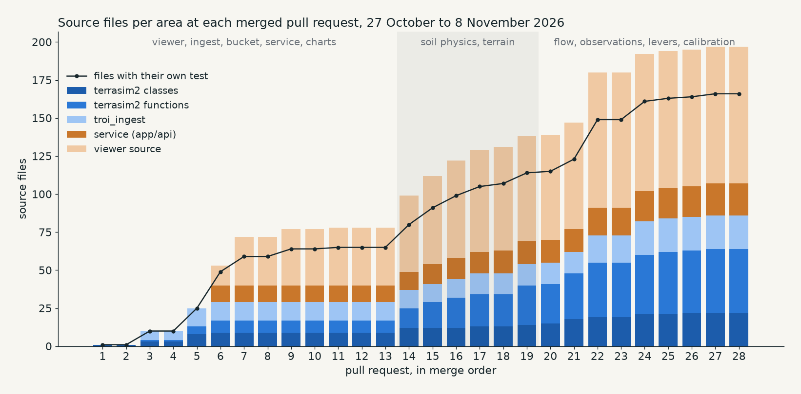

# History

<!-- nav -->
← [Development](development.md) · [Index](README.md)
<!-- /nav -->

Pull requests 1 to 28 were merged between 27 October and 8 November 2026. Pull requests 1 to 13 went into `main`. Pull requests 14 to 28 went into `soil-physics-with-python`, partly through stacked branches that pull request 28 brought in together.

Counted from git at the merge of pull request 28, the code base held:

- 22 classes and 42 functions in `terrasim2`;
- 22 units in `troi_ingest`;
- 21 units in the service;
- 90 source files in the viewer.

Of all these files, 166 carry their own test. The "Recorded result" column repeats what each pull request's description reported. These results were not re-run for this page.

## Phase 1: viewer, ingest, model loop, service (PRs 1–13, 27 Oct – 1 Nov)

| PR | What landed |
|---|---|
| 1–2 | The 3D terrain viewer and the Python unit conventions |
| 3–4 | `troi_ingest`: rain tiles on the terrain grid; the dense-site table |
| 5 | The bucket step, the run loop, the model inputs format, site ingest and the first committed sites |
| 6 | The zarr run store, `RunStoreParams`, and the `app/api` service |
| 7 | The run page: start a run, follow it live, scrub when complete |
| 8–10 | Playback and site-switch fixes |
| 9, 11, 12 | The series chart under the surface; drag to zoom; every flux as bars mirrored around zero |
| 13 | The committed inputs move to `data/dev_sites/` |

## Phase 2: soil physics and terrain (PRs 14–19, 4 Nov)

| PR | What landed |
|---|---|
| 14 | Chapter 5: retention curves, available water, and the page to see them |
| 15 | The texture triangle and the particle-size route to Campbell's curve |
| 16 | Layered capacity: available water summed over soil layers to a root depth |
| 17 | Model inputs v2: SLGA soil layers, capacity from texture, and a capacity map in the viewer |
| 18 | Root depth on runs, and run ids that follow the inputs |
| 19 | Flow directions: pit filling, steepest descent, flow order, and a drainage view |

## Phase 3: flow, observations, levers, calibration (PRs 20–28, 8 Nov)

| PR | What landed | Recorded result |
|---|---|---|
| 20 | Terrain derivatives on every step; the routed bucket | At Tarrawarra, under one rain tile, the routed bucket gave the same scores as the closed bucket |
| 21 | Subsurface flow: soil hydraulics on every step, a free store above field capacity | Lateral flow present but small at 10 m |
| 22 | Observations: the dense sites' measurements, a run scored against them, the comparison in the viewer | Tarrawarra, at the −33 J/kg convention then in use: NSE 0.64, mean within-survey r 0.15 |
| 23 | Lateral anisotropy on the subsurface step | A ×10 multiplier improved wet-month scores only; dry-month residuals correlated with slope |
| 24 | Vegetation: tree or grass per cell from a year of NDVI; a root depth per class | Too few profiles at MRI to test tree rooting |
| 25 | Aspect: demand follows the sun each slope receives | Tarrawarra within-survey r 0.15 → 0.36, NSE higher; at four of five sites the observed levels were outside the range the soil curves allowed |
| 26 | Soil: field capacity at −10 J/kg and wilting point at −500, calibrated against APSoil; every site re-scored | Closed-bucket bias halved at four of five sites; subsurface scores at Tarrawarra unchanged |
| 27 | Cover: demand follows each cell's persistent greenness relative to the site's mean | At Esdale, persistent cover correlated with lower surface content after controlling for aspect; no such effect at Tarrawarra |
| 28 | PRs 22–27 land together on `soil-physics-with-python` | |

## After 8 November

| PR | State on 24 November 2026 (from git) | Content |
|---|---|---|
| 29 | not merged | These pages |
| 30 | not merged | Fluxes named by process: `SUBSURFACE_LATERAL_FLOW` and `PERCOLATION` (with `percolation_fraction`) replace `DRAINAGE` and `LEAK`; the routed and subsurface steps record `SURFACE_FLOW` |
| 31 | merged into `main` | MIT licence |

Settings and scores per site are in [evaluation.md](evaluation.md).
