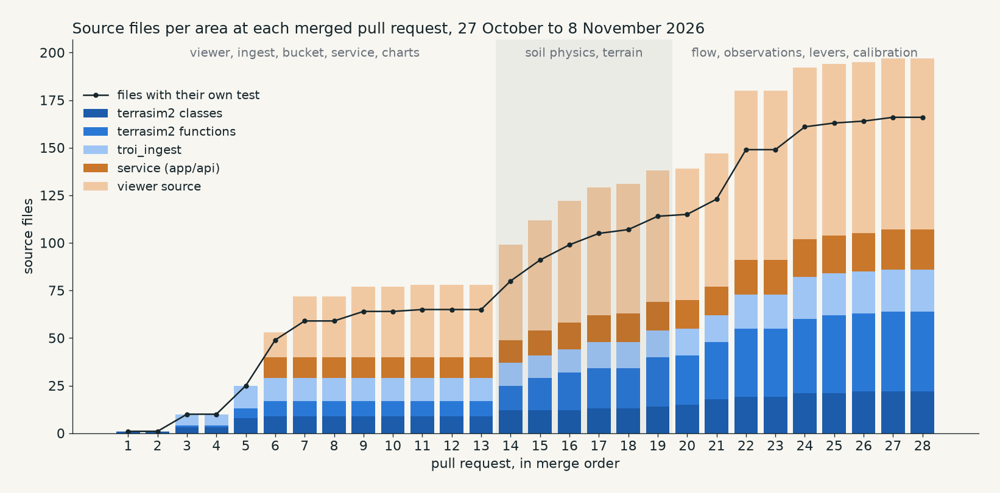

# History

<!-- nav -->
← [Development](development.md) · [Index](README.md)
<!-- /nav -->

Twenty-eight pull requests between 27 October and 8 November 2026, each merged after its measurement. Counted from git at each merge commit, the code base grew from one class to 22 classes and 42 functions in `terrasim2`, 22 units in `troi_ingest`, 21 in the service and 90 source files in the viewer, 166 of them carrying their own test.

## Phase 1: viewer, ingest, model loop, service (PRs 1–13, 27 Oct – 1 Nov)

| PR | What landed |
|---|---|
| 1–2 | The 3D terrain viewer and the Python unit conventions |
| 3–4 | `troi_ingest`: rain tiles on the terrain grid; the dense-site table |
| 5 | The bucket step, the run loop, the model inputs format, site ingest and the first committed sites |
| 6 | The zarr run store, `RunStoreParams`, and the `app/api` service |
| 7 | The run page: start a run, follow it live, scrub when complete |
| 8–10 | Playback and site-switch fixes |
| 9, 11, 12 | The series chart under the surface; drag to zoom; every flux as bars mirrored around zero |
| 13 | The committed inputs move to `data/dev_sites/` |

## Phase 2: soil physics and terrain (PRs 14–19, 4 Nov)

| PR | What landed |
|---|---|
| 14 | Chapter 5: retention curves, available water, and the page to see them |
| 15 | The texture triangle and the particle-size route to Campbell's curve |
| 16 | Layered capacity: available water summed over soil layers to a root depth |
| 17 | Model inputs v2: SLGA soil layers, capacity from texture, and a capacity map in the viewer |
| 18 | Root depth on runs, and run ids that follow the inputs |
| 19 | Flow directions: pit filling, steepest descent, flow order, and a drainage view |

## Phase 3: flow, observations, levers, calibration (PRs 20–28, 8 Nov)

From here each step was chosen from the previous step's measured shortfall; nothing was planned more than one step ahead.

| PR | What landed | What it found |
|---|---|---|
| 20 | Terrain derivatives on every step; the routed bucket | Under one rain tile the routed bucket changes nothing: lateral transfer must occur in the soil |
| 21 | Subsurface flow: soil hydraulics on every step, a free store above field capacity | Lateral flow is present but weak at 10 m; evaluation needed before more physics |
| 22 | Observations: the dense sites' measurements, a run scored against them, the comparison in the viewer | The free store reproduces Tarrawarra's level (NSE 0.64) but not its spatial pattern (r 0.15) |
| 23 | Lateral anisotropy on the subsurface step | A ×10 multiplier helps wet months only; dry-month residuals follow slope |
| 24 | Vegetation: tree or grass per cell from a year of NDVI; a root depth per class | Too few profiles at MRI to test tree rooting |
| 25 | Aspect: demand follows the sun each slope receives | The slope signal was aspect: spatial r 0.15 → 0.36 with NSE rising; levels sit off the soil curve at four of five sites |
| 26 | Soil: field capacity at −10 J/kg and wilting point at −500, calibrated against APSoil; every site re-scored | The level error was a convention error; the free store had been compensating for it |
| 27 | Cover: demand follows each cell's persistent greenness relative to the site's mean | Persistent cover dries Esdale's surface independently of aspect; no cover signal at Tarrawarra |
| 28 | PRs 22–27 land together on `soil-physics-with-python` | |

## Afterwards

| PR | What landed |
|---|---|
| 29 | These pages |
| 30 | The fluxes named by process: `SUBSURFACE_LATERAL_FLOW` and `PERCOLATION` (with `percolation_fraction`) in place of `DRAINAGE` and `LEAK`, and `SURFACE_FLOW` recorded by the routed and subsurface steps |

What the sites taught in detail, and the settings each ended with, are in [evaluation.md](evaluation.md).

<!-- nav -->
← [Development](development.md) · [Index](README.md)
<!-- /nav -->
