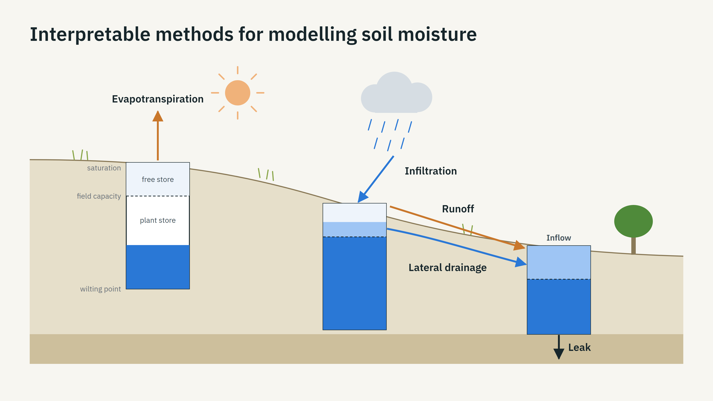

# Process steps

<!-- nav -->
← [Terrain](terrain.md) · [Index](README.md) · [Runs](runs.md) →
<!-- /nav -->

A step advances every cell one day. Three exist; they share one signature, the run loop, the soil hydraulics and the terrain derivatives, so new physics is a new step rather than a change to anything else.



## The protocol

```python
step(moisture, soil_hydraulics, rain, pet, terrain_derivatives, params) -> (moisture, fluxes)
```

| | Shape | Unit |
|---|---|---|
| `moisture` in and out | (rows, cols) | mm stored in the cell |
| `rain`, `pet` | (rows, cols) | mm for the day, already on cells (`get_values_on_cells` expands a tile series to the grid) |
| `fluxes` | (n_fluxes, rows, cols) | mm; the axis-0 index is the step's `IntEnum` of flux names |

`StepFunction` (`terrasim2/k/step_function.py`) is the `Protocol`. Mass balances per cell and over the grid every day; every step's tests check it.

## The closed bucket — `step_bucket_model`

One store per cell, the plant store, from wilting point to field capacity: `capacity` mm over the root depth. Rain infiltrates up to the room left; the rest overflows as runoff on the spot. Evaporation takes the demand times fullness to the stress exponent: `pet × (moisture / capacity) ** stress_exponent`. No lateral flow. Needs no retention curve, so it runs on inputs without soil layers.

- Parameters: `BucketModelParams(stress_exponent=1.0)`.
- Fluxes: `BucketFlux` INFILTRATION, RUNOFF, EVAPORATION.

## The routed bucket — `step_routed_bucket_model`

The same bucket, but a cell's overflow runs to its downstream cell in flow order within the day, and only outlets shed runoff. Water that reaches a cell with room infiltrates there.

- Parameters: `BucketModelParams`.
- Fluxes: `RoutedBucketFlux` INFILTRATION, INFLOW, RUNOFF, EVAPORATION.

Finding: under one 5 km rain tile the routed bucket changes nothing against the closed one. Every cell receives the same rain and overflows only when full, so overflow arriving downslope finds no room there either and runs on to the outlet. Lateral transfer has to occur in the soil.

## The subsurface step — `step_subsurface_bucket_model`

Two stores per cell: the plant store as before, and above it a free store between field capacity and saturation, `free_capacity` = (θs − θfc) × root depth mm. In one day, per cell, in flow order:

1. **Infiltration.** Rain and inflow from upslope enter up to the room left in both stores and up to the day's infiltration limit, Ks g t_rain (the saturated conductivity in kg s m⁻³ times gravity, over `rain_hours`); the remainder is surface excess.
2. **Drainage.** Free water drains to the downstream cell by Darcy's law at the Campbell conductivity of its content (eq. 6.35) over the cell's slope, multiplied by `lateral_multiplier` to stand for preferential flow; and downward out of the column by `leak_fraction` of the free store per day (0 is an impermeable base).
3. **Cascade.** Excess and drainage from the ridges arrive at the cells below within the same day; only outlets shed runoff.
4. **Evapotranspiration.** Reference demand, scaled by the cell's `solar_ratio` to the power `aspect_strength`, times plant-store fullness to the stress exponent.

- Parameters: `SubsurfaceBucketParams(stress_exponent=1.0, leak_fraction=0.0, rain_hours=24.0, lateral_multiplier=1.0, aspect_strength=0.0)`.
- Fluxes: `SubsurfaceBucketFlux` INFILTRATION, INFLOW, DRAINAGE, LEAK, RUNOFF, EVAPORATION.
- Requires a retention curve (`SoilHydraulics.require_conductivity()`).

## Levers outside the step

Two more levers act through the inputs rather than the step, so they apply to every step.

- **Root depth per cell.** `ModelInputs.root_depth` may be a `(rows, cols)` field; `SoilHydraulics` and the capacity map follow it. The service builds the field from the vegetation map when a request names a `tree_root_depth` (`compute_root_depth_field`): tree cells that deep, the rest `root_depth` ([vegetation.md](vegetation.md)).
- **Demand factor (cover).** `ModelInputs.demand_factor` is a positive field the reference evapotranspiration is multiplied by before every step (`run_model`: `pet_today = pet_today * inputs.demand_factor`). The service sets it from the vegetation map's crop coefficient divided by the grid's mean coefficient, raised to the request's `cover_strength` (`compute_demand_factor`); the division keeps the site's mean demand at the reference so only the pattern moves.

## What the evaluation made of them

At Tarrawarra the free store is what reaches the observed winter levels (the closed bucket cannot exceed field capacity, 0.30 m³/m³, and falls 0.15 below the surveys); the aspect lever is what organises the pattern within a survey (mean within-survey r 0.16 → 0.42); the lateral multiplier adds nothing at 10 m (0.38 at ×10, and NSE falls at ×10 and beyond); a leak of 0.01 removes a +0.03 bias at no cost to NSE, while 0.05 collapses it. See [evaluation.md](evaluation.md) for every site.

<!-- nav -->
← [Terrain](terrain.md) · [Index](README.md) · [Runs](runs.md) →
<!-- /nav -->
