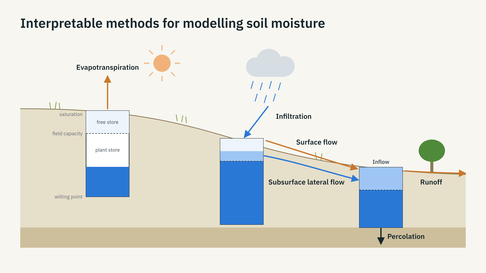

# Process steps

<!-- nav -->
← [Terrain](terrain.md) · [Index](README.md) · [Runs](runs.md) →
<!-- /nav -->

A step advances every cell by one day. There are three steps with one signature. All quantities are depths of water in mm over the cell.



## Signature

```python
step(moisture, soil_hydraulics, rain, pet, terrain_derivatives, params) -> (moisture, fluxes)
```

| Argument | Shape | Unit |
|---|---|---|
| `moisture`, in and out | (rows, cols) | mm stored |
| `rain`, `pet` | (rows, cols) | mm for the day, already on cells (`get_values_on_cells`) |
| `fluxes` | (n_fluxes, rows, cols) | mm for the day; axis 0 indexed by the step's `IntEnum` |

`StepFunction` (`terrasim2/k/step_function.py`) is the `Protocol`. Each step's `t()` checks the per-cell water balance stated below on a random grid, to 1e-9 mm.

## Closed bucket: `step_bucket_model`

One store per cell of size `capacity`.

1. Infiltration = min(rain, capacity − moisture). Rain beyond that is runoff, lost on the day.
2. Evaporation = min(pet × f^s, store), where f = store / capacity after infiltration and s = `stress_exponent`.

Balance: new − old = infiltration − evaporation. Terrain is not used, and the step needs only `capacity`.

Parameters: `BucketModelParams(stress_exponent=1.0)`. Fluxes (`BucketFlux`): INFILTRATION, RUNOFF, EVAPORATION.

## Routed bucket: `step_routed_bucket_model`

The closed bucket, but rain that does not fit (excess) passes to `downstream[cell]` within the day. Cells are visited in flow order. Each cell takes what arrives up to its remaining room (INFLOW) and passes the rest on (SURFACE_FLOW). At an outlet, what passes on leaves the grid (RUNOFF).

Balance per cell: new − old = infiltration + inflow − evaporation. Over the grid: total excess = total inflow + total runoff.

Parameters: `BucketModelParams`. Fluxes (`RoutedBucketFlux`): INFILTRATION, INFLOW, SURFACE_FLOW, RUNOFF, EVAPORATION.

At Tarrawarra this step gives the same whole-run scores as the closed bucket, to three decimals; other sites have not been compared. Every cell under one SILO tile receives the same rain and overflows only when its store is full. Water passed downslope therefore reaches cells that are also full, and runs on to an outlet.

## Subsurface step: `step_subsurface_bucket_model`

Each cell holds water up to saturation, in two ranges of the same root zone:

- the plant store, 0 to `capacity`;
- the free store above it, 0 to `free_capacity` = (θs − θfc) × root depth.

The two ranges are not separate depths. `moisture` is their sum. In one day:

1. **Infiltration.** Infiltration = min(rain, room left in the whole column, L), where L = Ks × g × `rain_hours` × 3600 (Ks in kg s m⁻³, g = 9.81 m s⁻²). The remainder is surface excess. Where Ks is unknown (NaN), L = 0 and no rain enters.
2. **Lateral flow and percolation.** Both are computed from the free water after infiltration, F = max(store − capacity, 0), at the Campbell conductivity K(θ) for θ = θfc + F / root depth:
   - SUBSURFACE_LATERAL_FLOW = min(m × K(θ) × g × slope × root depth / cell size × 86400, F), with m = `lateral_multiplier`. This is Darcy flow with a gravity gradient equal to the D8 slope, through a face one cell wide and one root depth high. The face width is one cell size in every direction, which overstates diagonal flow by up to √2.
   - PERCOLATION = min(K(θ) × g × p × 86400, F − lateral flow), with p = `percolation_fraction`. Percolated water leaves the model.
3. **Cascade.** Cells are visited in flow order. A cell first takes lateral flow arriving from upslope, up to its remaining room. It then takes surface water arriving from upslope, up to the room still left and the part of L not used in step 1. The sum is INFLOW. Untaken arrivals plus the cell's own excess pass to `downstream[cell]` over the surface (SURFACE_FLOW), and the cell's own lateral flow passes through the soil. At an outlet, both leave the grid (RUNOFF).
4. **Evapotranspiration.** EVAPORATION = min(D × f^s, store), where f = min(store, capacity) / capacity and D = pet × `solar_ratio`^`aspect_strength`. It is subtracted from the cell's total, so it removes free water first whenever free water is present.

Balance per cell: new − old = infiltration + inflow − lateral flow − percolation − evaporation. SURFACE_FLOW is water passing between cells. It does not enter the per-cell or grid balance, and on a cell it may count water that also appears in the surface flow of cells further down.

Parameters: `SubsurfaceBucketParams(stress_exponent=1.0, percolation_fraction=0.0, rain_hours=24.0, lateral_multiplier=1.0, aspect_strength=0.0)`. `percolation_fraction` must lie in [0, 1]; 0 makes the base impermeable. Fluxes (`SubsurfaceBucketFlux`): INFILTRATION, INFLOW, SURFACE_FLOW, SUBSURFACE_LATERAL_FLOW, PERCOLATION, RUNOFF, EVAPORATION.

The step calls `require_conductivity()` and fails on inputs without a retention curve.

Lateral flow and percolation are computed once per day from the state after infiltration. A cell's outflow therefore does not respond to water arriving the same day, and nothing limits how far water travels in a day.

## Settings applied outside the step

These act through `ModelInputs` and apply to all three steps.

- **Root depth per cell.** `root_depth` may be a `(rows, cols)` field, and capacity and hydraulics follow it. The service builds the field from the vegetation map when a request sets `tree_root_depth` (`compute_root_depth_field`). Tree cells take that depth and all other cells take `root_depth`.
- **Demand factor.** `demand_factor` multiplies the reference evapotranspiration before each step (`run_model`). The service sets it to (Kc / mean Kc)^`cover_strength`, where Kc is the crop coefficient from the vegetation map (`compute_demand_factor`). Cells with an unknown class get 1. The mean of Kc is the grid mean, so the factor redistributes demand within the site. The factor's own grid mean equals 1 only when `cover_strength` is 1. A `cover_strength` of 0 sets no factor.

## Not represented

Energy balance, plant growth, nutrients, interception, snow, vertical flow between soil layers, capillary rise, a water table, flow divided among several neighbours, channels, travel time within a day, sub-daily rainfall other than through `rain_hours`, and management.
